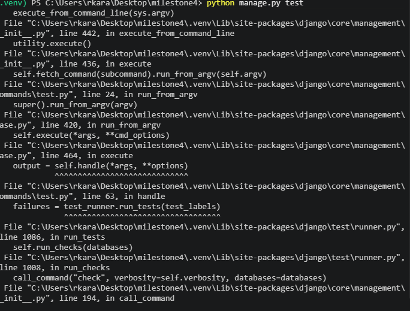

# The Old Ferryman

The Old Ferryman is a made-up gastropub in Norfolk, England. This project is its website, where customers can order pub food online, pay in advance and collect it at a time that suits them.

## Table of Contents

- [Purpose](#purpose)
- [Strategy](#strategy)
- [Project Goals](#project-goals)
- [Target Audience](#target-audience)
- [Research](#research)
- [User Stories](#user-stories)
- [Scope](#scope)
- [Feature Priorities (MoSCoW)](#feature-priorities-moscow)
- [Structure](#structure)
- [Wireframes and Mockups](#wireframes-and-mockups)
- [Bugs](#bugs)
- [Credits](#credits)

## Purpose

Ordering takeaway by phone is slow. Customers can wait on hold, they cannot see the full menu, and they do not know when their food will be ready. Staff have to stop working to answer the phone, and it is easy to get an order wrong.

The Old Ferryman solves this by putting the whole process online. Customers choose their food, pick a collection time, pay by card and then follow the status of their order. Staff can see all orders in one place and update them as they go.

The site is also a demo for my web design business, to show pubs, cafes and restaurants what an ordering system could look like for them.

## Strategy

The main users are customers who want to order pub food for collection, and the staff who prepare those orders. The site focuses on one clear job: getting from the menu to a paid order in a few simple steps.

Customers can look at the menu without an account, so they can decide before signing up. They need an account to order, because it lets them follow their order and see it again later. Staff use their own page to see new orders and update their status.

The project is built for a pub, but the same idea could work for a cafe, a restaurant or any other food business that offers collection.

## Project Goals

### Customer goals

- Find the menu, prices and allergens quickly.
- Order and pay online without phoning the pub.
- Know when the food is ready to collect.

### Business goals

- Take orders without staff having to answer the phone.
- Make fewer mistakes with orders.
- Keep all orders in one place.
- Show other local businesses what an ordering system could do for them.

## Target Audience

| User | What they want |
| --- | --- |
| New visitor | To see the menu and prices quickly |
| Returning customer | To order faster and see past orders |
| Customer with allergies | To check allergens before ordering |
| Restaurant staff | To see orders and update their status |
| Restaurant owner | To manage the menu and prices |

## Research

I looked at the websites of real pubs in Norfolk to see what works well and what could be better.

### Website 1 - The Boathouse, Ormesby Broad

<https://theboathouseormesbybroad.co.uk/>

A country pub with a restaurant, rooms and a wedding venue.

#### The Boathouse: what's good?

- Clear homepage tiles for dining, weddings and stays.
- Contact details are easy to find.

#### The Boathouse: what's bad?

- I could not find online food ordering on the homepage.

#### The Boathouse: what features could I use?

- Clear sections on the homepage.
- Simple navigation.

#### The Boathouse: what could I improve?

- Let customers order and pay online.
- Show allergens with each dish.

### Website 2 - Kings Arms, Ludham

<https://www.kingsarmsludham.co.uk/>

A family-run pub and carvery on the Norfolk Broads.

#### Kings Arms: what's good?

- A short one-page layout.
- Clear opening and food times.
- A phone number you can tap to call.

#### Kings Arms: what's bad?

- The full menu is a PDF.
- I could not find a way to book or order online.

#### Kings Arms: what features could I use?

- Opening times and contact details that are easy to find.

#### Kings Arms: what could I improve?

- Make the menu a normal web page that works well on a phone.
- Let customers order online.

### Research Outcomes

Both pubs have clear websites with useful information, but I could not find online ordering on either homepage. This shows the gap The Old Ferryman can fill: customers can see the full menu on any device, order online and pay in advance.

## User Stories

### Must-have stories

"As a new visitor, I want to see the menu and prices, so I can decide what to order."

Feature: A menu page with food categories and prices.

"As a customer with allergies, I want to check the allergens in a dish, so I can order safely."

Feature: A food detail page with a description and allergens.

"As a customer, I want to create an account and log in, so I can follow my order."

Feature: Register, log in and log out.

"As a customer, I want to add, change and remove items in my bag, so I can get my order right before I pay."

Feature: A shopping bag.

"As a customer, I want to pay online, so I do not need to pay when I collect my food."

Feature: Stripe checkout in test mode.

"As a customer, I want to know if my payment worked, so I am sure my order was placed."

Feature: Clear messages for successful and failed payments.

"As a customer, I want to follow my order after paying, so I know when my food is ready."

Feature: An order tracking page that is available after payment.

"As a customer, I want to write, edit and delete my reviews, so I can share my opinion and change it later."

Feature: Reviews that customers can create, edit and delete.

"As a member of staff, I want to see orders and update their status, so customers know how their order is going."

Feature: A staff page to see orders and update their status.

### Should-have stories

"As a customer with allergies, I want to search and filter the menu, so I can find suitable dishes quickly."

Feature: Search and filter by category or allergen.

"As a customer, I want to choose a collection time, so I can pick up my food when it suits me."

Feature: A choice of collection time at checkout.

"As a returning customer, I want to see my past orders, so I can remember what I ordered."

Feature: Order history in the user profile.

"As a returning customer, I want my contact details to be saved, so I can check out faster."

Feature: Saved contact details for faster checkout.

### Could-have stories

"As a customer, I want the order status to update by itself, so I do not need to refresh the page."

Feature: Live order status without refreshing the page.

"As a new visitor, I want to see the average rating of a dish, so I can choose something popular."

Feature: An average star rating on each food item.

"As a customer, I want an email after ordering, so I have a record of my order."

Feature: Order confirmation emails.

## Scope

### MVP (minimum viable product)

The MVP is the smallest version of the site that still works. A customer must be able to choose food, pay and follow their order.

I put each user story into one of three groups:

- **Must-have:** the site does not work without these, so I build them first.
- **Should-have:** these make ordering easier, but the site works without them.
- **Could-have:** nice extras. I add these if I have time.

### Responsive design

The site must work on phones, tablets and desktops. This is not a separate user story because it applies to every page.

## Feature Priorities (MoSCoW)

### Must have

- Menu page with food categories and prices
- Food detail page with description and allergens
- Register, log in and log out
- Shopping bag where items can be added, changed and removed
- Stripe checkout in test mode
- Clear messages for successful and failed payments
- Order tracking page that is available after payment and shows the order status: Received, Preparing or Ready
- Reviews that customers can create, edit and delete
- Staff page to see orders and move them from Received to Preparing to Ready

### Should have

- Search and filter by category or allergen
- Choice of collection time at checkout
- Order history in the user profile
- Saved contact details for faster checkout
- Only customers who have collected an order can write a review

### Could have

- Carousel of pub favourites on the homepage, made with my own JavaScript
- Live order status without refreshing the page
- Average star rating on each food item
- Order confirmation emails

### Won't have (for now)

- Delivery by driver
- Table booking
- Loyalty points
- A mobile app

## Structure

### Site structure

- **Navigation bar:** Home and Menu, plus Log in and Register for visitors or Log out for signed-in users.
- **Homepage:** a hero with an Order now button, How it works, Pub favourites and an introduction to the pub.
- **Menu:** food and drink sorted into categories, with prices and allergens.
- **Bag:** the items a customer has chosen and the total price.
- **Checkout:** payment by card, added with the Stripe feature.
- **Order tracking:** the status of a paid order, added after checkout.
- **Staff orders:** a page for staff to see and update orders, added after order tracking.

### User journey

1. A visitor opens the homepage and sees what the pub offers.
2. They choose Order now and look through the menu.
3. They add dishes to their bag and check the total.
4. They log in or register, then pay by card.
5. They see a message that says whether the payment worked.
6. They follow their order until it is ready to collect.

Staff see the new order on their own page and update its status, and the customer can see each change.

## Wireframes and Mockups

These boards show the planned pages. They were made before coding, using the placeholder name BistroBell and example dishes, so the finished site will use The Old Ferryman branding and pub food. Collection replaces the delivery tracking shown here, and Stripe is the only payment method.

- [Desktop wireframes and mockups](docs/wireframes/desktop-wireframes-and-mockups.png)
- [Mobile wireframes and mockups](docs/wireframes/mobile-wireframes-and-mockups.png)

Tablet wireframes are still to be added.

## Bugs

I wrote down each bug when it happened, what caused it and how I fixed it.

### 1. Menu code pasted into the wrong file

**Bug:** after adding sorting to the menu, the whole site stopped working and the tests would not run. The error said:

```text
File "bag/views.py", line 5
ImportError: cannot import name 'Category' from 'bag.models'
```



**Cause:** I pasted the new sorting code into `bag/views.py` instead of `menu/views.py`. This replaced the bag code, and I committed it before noticing. The error message helped, because it named the file and the line.

**Fix:** `git restore bag/views.py` did not help, because it brought back the broken version from my last commit. I used `git restore --source=HEAD~1 bag/views.py` to get the bag code from the commit before, and moved the sorting code to `menu/views.py`.

**What I learned:** run the tests and check `git status` before every commit.

### 2. Typos in the menu sorting code

**Bug:** after moving the sorting code, four menu tests failed.

**Cause:** two small mistakes in `menu/views.py`:

- I used round brackets in `f'(sort)_(direction)'`, so it saved the text "(sort)" instead of the real values.
- I left out `to_attr='available_items'` in `Prefetch`, so the template could not find the dishes.

**Fix:** I changed the first line to `f'{sort}_{direction}'` and added `to_attr='available_items'` back. All the menu tests passed after that.

### 3. Zero quantity test expected the wrong result

**Bug:** the test `test_zero_quantity_is_not_added` failed, even though the bag worked correctly.

**Cause:** the test sends a quantity of 0, but its last line still expected 1 portion in the bag. The bag code was right, because it stays empty. The test itself was wrong.

**Fix:** I changed the last line so it expects an empty bag: `{}`. All 27 tests now pass.

## Credits

### AI assistance

I used ChatGPT to help with the wireframes and Claude to help with planning the project.

### Libraries

- [Bootstrap 5.3.3](https://getbootstrap.com/) for layout and the navigation menu
- [django-allauth](https://allauth.org/) for registration and login
- [IM Fell English](https://fonts.google.com/specimen/IM+Fell+English) from Google Fonts for the pub name

### Design images

The wireframe and mockup boards in docs/wireframes were generated with ChatGPT (OpenAI).

### Photos

| Photo | Creator | Source | Licence |
| --- | --- | --- | --- |
| Pub interior | [Pexels](https://pixabay.com/users/pexels-2286921/) | [Pixabay](https://pixabay.com/photos/restaurant-furniture-interiors-1837150/) | [Pixabay Content License](https://pixabay.com/service/license-summary/) |
| Salmon teriyaki | [Wow_Pho](https://pixabay.com/users/wow_pho-916237/) | [Pixabay](https://pixabay.com/photos/food-salmon-teriyaki-fish-eat-712665/) | [Pixabay Content License](https://pixabay.com/service/license-summary/) |
| Pizza | [MatteoPhotoPro2020](https://pixabay.com/users/matteophotopro2020-11599221/) | [Pixabay](https://pixabay.com/photos/pizza-kitchen-pizzeria-food-tomato-5275191/) | [Pixabay Content License](https://pixabay.com/service/license-summary/) |
| Pizza and salad | [Sarda_Bamberg](https://pixabay.com/users/sarda_bamberg-32538049/) | [Pixabay](https://pixabay.com/photos/food-pizza-pizzeria-salad-7724008/) | [Pixabay Content License](https://pixabay.com/service/license-summary/) |
| Burger | [2SIF](https://pixabay.com/users/2sif-26811215/) | [Pixabay](https://pixabay.com/photos/burger-double-burger-hamburger-food-7323697/) | [Pixabay Content License](https://pixabay.com/service/license-summary/) |
| Chicken burger | [SylwesterL](https://pixabay.com/users/sylwesterl-34617078/) | [Pixabay](https://pixabay.com/photos/hamburger-sandwich-chicken-healthy-8026581/) | [Pixabay Content License](https://pixabay.com/service/license-summary/) |
| Blueberry cheesecake | [thezworld](https://pixabay.com/users/thezworld-13524303/) | [Pixabay](https://pixabay.com/photos/blue-berry-cheese-cake-blue-berry-4547988/) | [Pixabay Content License](https://pixabay.com/service/license-summary/) |
| Cheesecake | [matthiasboeckel](https://pixabay.com/users/matthiasboeckel-3930681/) | [Pixabay](https://pixabay.com/photos/cake-cheesecake-pastry-yummy-7796383/) | [Pixabay Content License](https://pixabay.com/service/license-summary/) |
| Chocolate cake | [Rbribella12](https://pixabay.com/users/rbribella12-52121918/) | [Pixabay](https://pixabay.com/photos/chocolate-cake-dessert-10261167/) | [Pixabay Content License](https://pixabay.com/service/license-summary/) |
| Fish and chips | [Timbigger](https://pixabay.com/users/timbigger-1333127/) | [Pixabay](https://pixabay.com/photos/fish-and-chips-cod-and-chips-8645438/) | [Pixabay Content License](https://pixabay.com/service/license-summary/) |
| Fish burger | [Abdullah_Shakoor](https://pixabay.com/users/abdullah_shakoor-5012922/) | [Pixabay](https://pixabay.com/photos/outback-steak-burger-khobar-fish-2492925/) | [Pixabay Content License](https://pixabay.com/service/license-summary/) |
| Shepherd's pie | [TehzeebNoah](https://pixabay.com/users/tehzeebnoah-56285559/) | [Pixabay](https://pixabay.com/photos/shepherds-pie-mashed-potato-meat-10366225/) | [Pixabay Content License](https://pixabay.com/service/license-summary/) |
| Meat pie | [tehzeebkazmii](https://pixabay.com/users/tehzeebkazmii-46957846/) | [Pixabay](https://pixabay.com/photos/meat-pie-pastry-crust-savory-beef-10366164/) | [Pixabay Content License](https://pixabay.com/service/license-summary/) |
| Roast duck | [RitaE](https://pixabay.com/users/ritae-19628/) | [Pixabay](https://pixabay.com/photos/roast-duck-roasted-duck-dumplings-1812345/) | [Pixabay Content License](https://pixabay.com/service/license-summary/) |
| Beef steak | [Rierosa222](https://pixabay.com/users/rierosa222-5673828/) | [Pixabay](https://pixabay.com/photos/beef-steak-meat-food-tenderloin-2509104/) | [Pixabay Content License](https://pixabay.com/service/license-summary/) |
| Sandwich | [rajdeepcraft](https://pixabay.com/users/rajdeepcraft-15019006/) | [Pixabay](https://pixabay.com/photos/sandwich-food-hamburger-burger-5930496/) | [Pixabay Content License](https://pixabay.com/service/license-summary/) |
| Burger and fries | [Fclaria](https://pixabay.com/users/fclaria-2588417/) | [Pixabay](https://pixabay.com/photos/hamburger-food-burger-fries-salad-1414423/) | [Pixabay Content License](https://pixabay.com/service/license-summary/) |
| Fries | [learningwithsultan](https://pixabay.com/users/learningwithsultan-43875329/) | [Pixabay](https://pixabay.com/photos/fries-burger-food-fried-souce-9878943/) | [Pixabay Content License](https://pixabay.com/service/license-summary/) |
| Chicken nuggets (6 piece) | [adoproducciones](https://pixabay.com/users/adoproducciones-121887/) | [Pixabay](https://pixabay.com/photos/chicken-nuggets-fries-dip-sauce-246179/) | [Pixabay Content License](https://pixabay.com/service/license-summary/) |
| Chicken nuggets (10 piece) | [ImpulsoGrafico](https://pixabay.com/users/impulsografico-3210029/) | [Pixabay](https://pixabay.com/photos/chicken-nuggets-fried-fries-food-4473035/) | [Pixabay Content License](https://pixabay.com/service/license-summary/) |
| Chocolate dessert bars | [paulitasolange](https://pixabay.com/users/paulitasolange-18629985/) | [Pixabay](https://pixabay.com/photos/dessert-treat-snack-white-chocolate-5804153/) | [Pixabay Content License](https://pixabay.com/service/license-summary/) |
| Creme caramel | [tehzeebhud](https://pixabay.com/users/tehzeebhud-55260852/) | [Pixabay](https://pixabay.com/photos/flan-creme-caramel-caramel-pudding-10455212/) | [Pixabay Content License](https://pixabay.com/service/license-summary/) |
| Baby puree | [MapleHorizons](https://pixabay.com/users/maplehorizons-8423583/) | [Pixabay](https://pixabay.com/photos/food-healthy-diet-nutrients-3245374/) | [Pixabay Content License](https://pixabay.com/service/license-summary/) |
| Pumpkin soup | [panchenko_karyna](https://pixabay.com/users/panchenko_karyna-3712352/) | [Pixabay](https://pixabay.com/photos/soup-pumpkin-soup-pumpkin-puree-6946614/) | [Pixabay Content License](https://pixabay.com/service/license-summary/) |
| Carrot soup | [Einladung_zum_Essen](https://pixabay.com/users/einladung_zum_essen-3625323/) | [Pixabay](https://pixabay.com/photos/soup-carrot-ginger-food-meal-2006317/) | [Pixabay Content License](https://pixabay.com/service/license-summary/) |
| Fruit puree | [MapleHorizons](https://pixabay.com/users/maplehorizons-8423583/) | [Pixabay](https://pixabay.com/photos/food-healthy-diet-nutrients-3245379/) | [Pixabay Content License](https://pixabay.com/service/license-summary/) |
| Tomato soup | [tortic84](https://pixabay.com/users/tortic84-2633672/) | [Pixabay](https://pixabay.com/photos/tomato-soup-soup-gazpacho-2288056/) | [Pixabay Content License](https://pixabay.com/service/license-summary/) |
| Pumpkin soup (second photo) | [RitaE](https://pixabay.com/users/ritae-19628/) | [Pixabay](https://pixabay.com/photos/pumpkin-soup-soup-food-3645375/) | [Pixabay Content License](https://pixabay.com/service/license-summary/) |
| Beef steak (second photo) | [RitaE](https://pixabay.com/users/ritae-19628/) | [Pixabay](https://pixabay.com/photos/steak-meat-beef-steak-food-beef-3640560/) | [Pixabay Content License](https://pixabay.com/service/license-summary/) |
| Beef stew and fries | [u_7yox7ioz1z](https://pixabay.com/users/u_7yox7ioz1z-34455389/) | [Pixabay](https://pixabay.com/photos/beef-steak-filet-fries-meal-7855926/) | [Pixabay Content License](https://pixabay.com/service/license-summary/) |
| Vegetarian pasta | [MichelRigottiPhotographer](https://pixabay.com/users/michelrigottiphotographer-49203998/) | [Pixabay](https://pixabay.com/photos/pasta-food-carbohydrates-italian-9450866/) | [Pixabay Content License](https://pixabay.com/service/license-summary/) |
| Tofu noodles | [joannawielgosz](https://pixabay.com/users/joannawielgosz-168212/) | [Pixabay](https://pixabay.com/photos/pasta-coriander-salad-food-dish-7209002/) | [Pixabay Content License](https://pixabay.com/service/license-summary/) |
| Baby eating puree | [Ben_Kerckx](https://pixabay.com/users/ben_kerckx-69781/) | [Pixabay](https://pixabay.com/photos/child-vegetable-pap-power-supply-818432/) | [Pixabay Content License](https://pixabay.com/service/license-summary/) |
| Vegetarian burger | Pixabay user 16944022 | [Pixabay](https://pixabay.com/photos/vegan-burger-fries-vegetarian-meal-6498367/) | [Pixabay Content License](https://pixabay.com/service/license-summary/) |
| Broccoli and potato bake | [Einladung_zum_Essen](https://pixabay.com/users/einladung_zum_essen-3625323/) | [Pixabay](https://pixabay.com/photos/broccoli-potato-casserole-baked-1804446/) | [Pixabay Content License](https://pixabay.com/service/license-summary/) |
| Pirate captain illustration (AI generated) | [CreativeCanvasDesign](https://pixabay.com/users/creativecanvasdesign-45016655/) | [Pixabay](https://pixabay.com/vectors/pirate-captain-cartoon-character-10313874/) | [Pixabay Content License](https://pixabay.com/service/license-summary/) |
| Salmon dish | [cattalin](https://pixabay.com/users/cattalin-560479/) | [Pixabay](https://pixabay.com/photos/new-years-eve-salmon-fish-seafood-518032/) | [Pixabay Content License](https://pixabay.com/service/license-summary/) |
