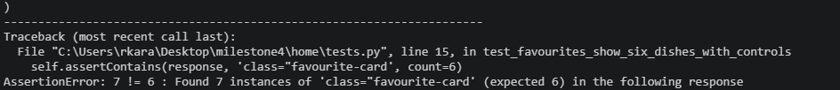
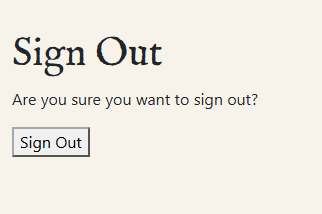
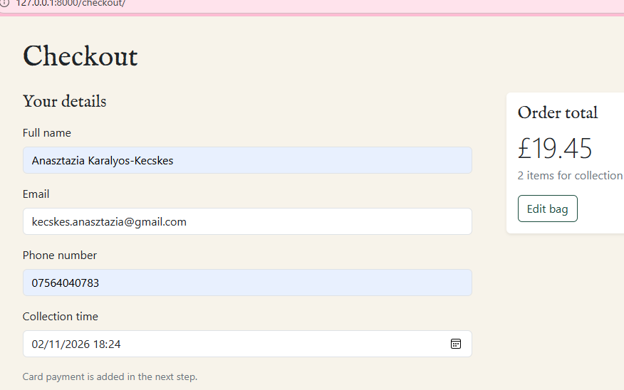

# Testing

## Automated tests

The project uses Django's built-in test framework. Run all tests with:

```text
python manage.py test
```

## Bugs

### 1. Bag stopped working after adding menu sorting

**Bug:** the tests would not run: `ImportError: cannot import name 'Category' from 'bag.models'`.


**Fix:** restored `bag/views.py` with git and moved the sorting code to `menu/views.py`.

### 2. Homepage favourites test failed

**Bug:** `AssertionError: 7 != 6` in the favourites test.



**Fix:** updated the test to expect 7 dishes.

### 3. No test could run and the server would not start

**Bug:** `SyntaxError: '{' was never closed` in `checkout/views.py`.


**Fix:** added `})` back.

### 4. Checkout form accepted a collection time in the past

**Bug:** `test_collection_time_in_the_past_is_invalid` failed with `AssertionError: True is not false`.


**Fix:** added `clean_collection_time` back to `OrderForm`.

### 5. Past collection time still accepted after adding the check back

**Bug:** the same test still failed with `AssertionError: True is not false`.

**Fix:** finished the method with the `if`, the `raise` and `return collection_time`.

### 6. Sign out page had no way to go back

**Bug:** the sign out page only had a plain "Sign Out" button, with no way to cancel.



**Fix:** added my own `templates/account/logout.html` with a green "Sign out" button and a "Cancel" button.

### 7. Checkout form let me pick a collection time in the past

**Bug:** the date picker let me choose a date that had already passed.



**Fix:** finished `clean_collection_time` and added a `min` value to the input.

### 8. A collection time one hour ahead was rejected

**Bug:** `test_collection_time_in_one_hour_is_valid` failed with `AssertionError: False is not true`.

**Fix:** changed the minimum time from 60 minutes to 20 minutes, so an order for one hour ahead is accepted.
