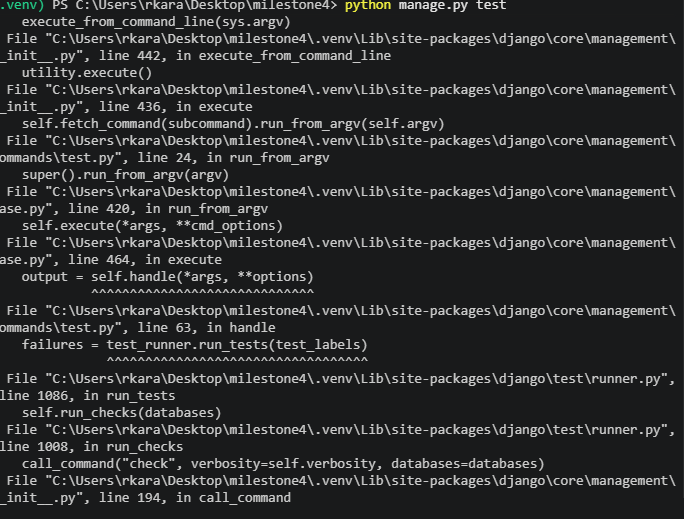
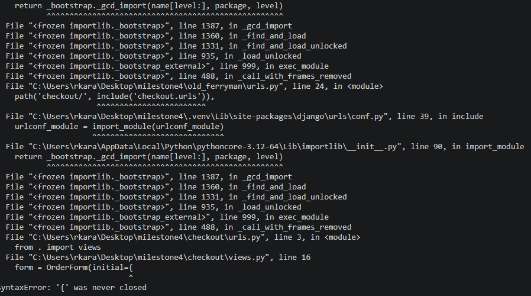
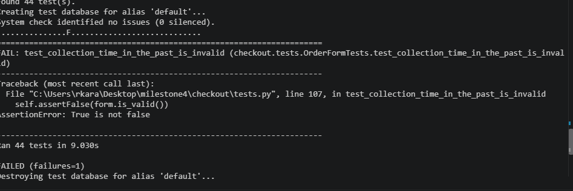

# Testing

## Automated tests

The project uses Django's built-in test framework. Run all tests with:

```text
python manage.py test
```

## Bugs found by the tests

### 1. Site stopped working after pasting code into the wrong file

**Bug:** after adding sorting to the menu, the tests would not run. The error said:

```text
File "bag/views.py", line 5
ImportError: cannot import name 'Category' from 'bag.models'
```



**Cause:** I pasted the new sorting code into `bag/views.py` instead of `menu/views.py`, so the bag code was replaced.

**Fix:** I used `git restore --source=HEAD~1 bag/views.py` to get the bag code back, and moved the sorting code to `menu/views.py`. More detail is in the Bugs section of the [README](README.md#bugs).

### 2. Homepage favourites test failed after changing the dishes

**Bug:** after I changed the dishes on the homepage, one test failed:

```text
FAIL: test_favourites_show_six_dishes_with_controls (home.tests.HomePageTests)
  File "home/tests.py", line 15, in test_favourites_show_six_dishes_with_controls
    self.assertContains(response, 'class="favourite-card', count=6)
AssertionError: 7 != 6 : Found 7 instances of 'class="favourite-card' (expected 6)

Ran 28 tests
FAILED (failures=1)
```


**Cause:** I replaced Homemade Baby Puree with two dishes, Steak Pie and Beef Steak, so the homepage now has 7 cards. The test still expected 6 cards and the text "Baby Puree".

**Fix:** I updated the test to expect 7 cards and to check for "Steak Pie" instead of "Baby Puree". After the fix all 28 tests passed.

**What I learned:** always run the full `python manage.py test`, not just one app, because a change in one page can break a test in another app.

### 3. Missing bracket in the checkout view stopped every test

**Bug:** after I removed the closing `})` in `checkout/views.py`, no test could run and the server would not start. The error said:

```text
File "checkout/urls.py", line 3, in <module>
    from . import views
File "checkout/views.py", line 16
    form = OrderForm(initial={
                             ^
SyntaxError: '{' was never closed
```



**Cause:** the line `form = OrderForm(initial={` opens a bracket `(` and a curly bracket `{`. Without `})` at the end, Python cannot read the file. Django loads every app's URLs when it starts, so one broken file stops the whole site, not only the checkout.

**Fix:** I put `})` back after the last line of the dictionary. Brackets close in the opposite order to how they open, so `}` comes first and then `)`. After the fix 43 tests passed and only the collection time test failed, because I had also removed that check.

**What I learned:** read a long error from the bottom up. The last lines name the file, the line and the problem, and the `^` points at the bracket that was never closed.

### 4. Checkout form accepted a collection time in the past

**Bug:** after I removed the collection time check from `checkout/forms.py`, one test failed:

```text
FAIL: test_collection_time_in_the_past_is_invalid (checkout.tests.OrderFormTests)
  File "checkout/tests.py", line 107, in test_collection_time_in_the_past_is_invalid
    self.assertFalse(form.is_valid())
AssertionError: True is not false

Ran 44 tests
FAILED (failures=1)
```



**Cause:** the test fills in the form with a collection time in the past and expects the form to be invalid. Without the `clean_collection_time` method the form had no rule about the time, so it said the form was valid. A customer could have ordered food for yesterday.

**Fix:** I put `clean_collection_time` back in `OrderForm`. It checks that the collection time is at least 20 minutes from now, because the kitchen needs time to cook, and shows "Please choose a time at least 20 minutes from now." if it is not. After the fix all 44 tests passed.

**What I learned:** "True is not false" means the test expected `False` but got `True`. Here the form said "valid" when it should have said "invalid", so the missing piece was a validation rule, not a crash.
